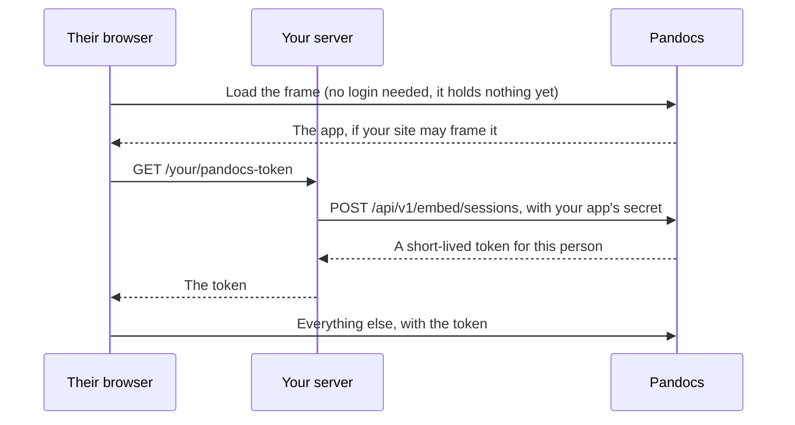

# Embedding pages in another system

A page can live inside another web app, with reading, comments and suggestions working as they do on the site. It is the same page, in a frame, so what people see there and what they see on the site cannot drift apart. The only addition is how the other system says who its users are.

## How it fits together



Your server decides who the person is, using its own login. Pandocs trusts it for that, and for nothing else: what they can reach is still decided here.

## Setting it up

**1. Add the app.** As an administrator, go to *Embed apps*, give it a name, an identifier such as `helpdesk`, and the sites allowed to frame it. Save the secret somewhere your server can read it. It is shown once.

**2. Grant access.** Visitors from another system get nothing by default: not a space's default role, and not what everyone on the site gets. In a space's members, add `group:embed:helpdesk` with the role they should have. A `commenter` can read, comment and suggest. An `editor` can save.

To treat some of their people differently, send groups with the session. A person in group `support` is also in `group:embed:helpdesk:support`, so that can have its own role. A system can only ever name groups below its own, so it can never claim one of this site's.

**3. Hand out tokens from your server.**

```js
// Express, but anything works. Check the person is logged in with you first.
app.get("/your/pandocs-token", requireLogin, async (req, res) => {
  const answer = await fetch("https://docs.example.com/api/v1/embed/sessions", {
    method: "POST",
    headers: { authorization: `Bearer ${process.env.PANDOCS_EMBED_SECRET}`, "content-type": "application/json" },
    body: JSON.stringify({ user: { id: req.user.id, displayName: req.user.name, groups: req.user.teams } })
  });
  const { data } = await answer.json();
  res.type("text/plain").send(data.token);
});
```

**4. Put the page in.** With no build step, from your site itself:

```html
<pandocs-doc server="https://docs.example.com" app="helpdesk" space="handbook" path="getting-started" style="height: 800px"></pandocs-doc>
<script type="module">
  import "https://docs.example.com/embed.js";
  document.querySelector("pandocs-doc").getToken = async () => (await fetch("/your/pandocs-token")).text();
</script>
```

Or with React, from `@pandocs/embed`:

```jsx
import { PandocsDoc } from "@pandocs/embed/react";

<PandocsDoc
  server="https://docs.example.com"
  app="helpdesk"
  space="handbook"
  path="getting-started"
  style={{ height: 800 }}
  getToken={async () => (await fetch("/your/pandocs-token")).text()}
  onNavigate={path => console.log("now on", path)}
/>;
```

## The element

| Attribute | |
| --- | --- |
| `server` | The site's address. |
| `app` | The app's identifier. |
| `space`, `path` | The page. Change them to go somewhere else. They follow along when someone follows a link inside the frame. |
| `theme` | `light` or `dark`. Can change at any time. |
| `lang` | `en` or `zh`, for the page's own text. Otherwise it follows the person's browser. |
| `sidebar` | Present to show the space's page tree beside the page. |

Set `getToken` to a function returning a token. It is called on load, and again shortly before the token runs out.

| Event | |
| --- | --- |
| `pandocs-ready` | The page has a token and is loading. |
| `pandocs-navigate` | Someone went to another page. `event.detail.path` says where. |
| `pandocs-error` | Something went wrong getting a token. `event.detail.error` says what. |

## What keeps this safe

- **The secret stays on your server.** It is hashed here and only ever shown once. Nothing about the endpoint helps a browser call it.
- **Tokens are short-lived, an hour by default and twelve at most**, and held only in memory in the frame, so they are not left in cookies or storage. Browsers increasingly block cookies in frames from other sites, and this does not rely on them.
- **Only listed sites can frame it.** Browsers enforce this through `Content-Security-Policy: frame-ancestors`, from the list on the app.
- **A token cannot do what a guest should not.** Account pages, API tokens, the people directory, administration and MCP are all closed to it, whatever role it has been granted.
- **Disabling an app stops all its tokens at once.** Replacing the secret stops new tokens only, as tokens already out stay valid until they run out.
- **Images and event streams use a separate read-only ticket in their address**, because they cannot carry a header. It opens nothing else. If an address like that ends up in a proxy's log, what it opens is limited to those, for what is left of its short life.

Comments and revisions by a visitor are recorded under `embed:<app>:<id>`, with the name your system gave, and show up in the audit log like any other.
