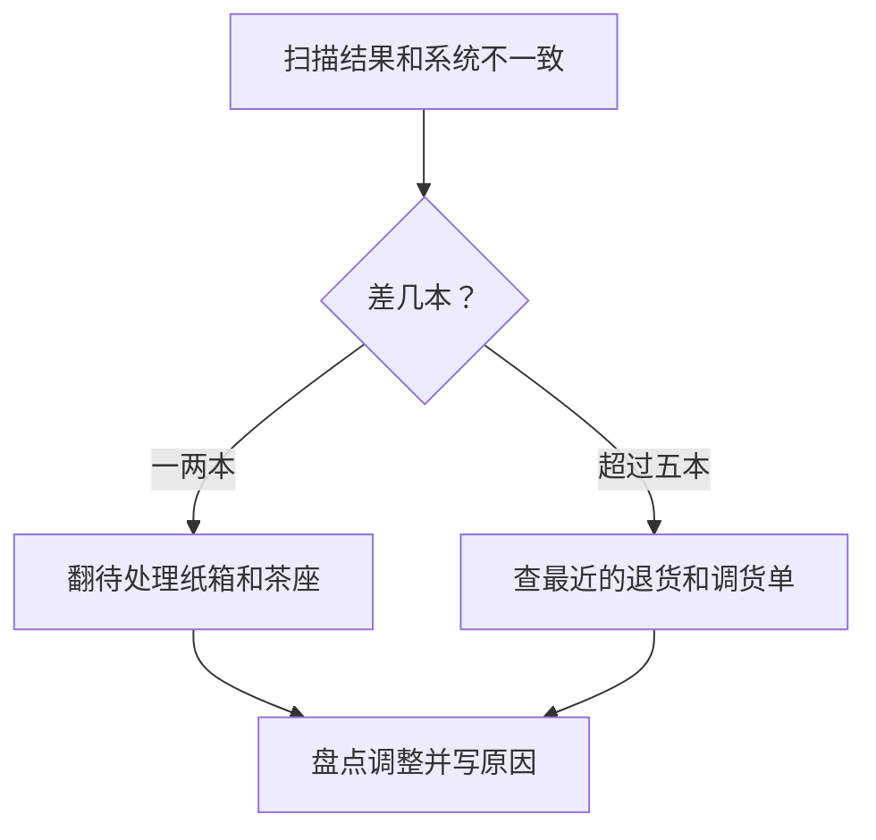

一箱书从进门到上架要过几关，月底盘点又怎么做才不用返工，都在这一页。平时管到货和书架的同事最常用到。

# 收货核对

快递到了先别拆。对照随箱清单点箱数，箱子破损的话当场拍照，让快递员在单子上写明。这一步偷懒，后面出版社不认账。

拆箱以后逐本扫码。系统会提示三种结果：

- **绿色**：和订单一致，放到推车上。
- **黄色**：数量多了。多出来的单独放，写张纸条贴上，等店长联系出版社。
- **红色**：订单里没有这本书。可能是发错了，**不要入库**。

# 上架

新书先放新书区两周，两周后回分类架。分类架的编号写在层板侧面，例如 `L-3-2` 是文学区第三排第二层。

:::::columns

::::column{width="0.5"}

**放新书台的时候**

封面朝上，一摞不超过七本，太高了读者不敢拿。系列书放一起，第一册放最上面。

::::

::::column{width="0.5"}

**放分类架的时候**

按作者拼音排序，同一作者按出版时间。书不要塞得太紧，留一指宽，读者才抽得出来。

::::

:::::

# 月底盘点

每月最后一个周一闭店盘点。两人一组，一个人扫，一个人核对位置，每半小时换一次手，不然眼睛会花。

| 时间 | 做什么 | 负责人 |
| --- | --- | --- |
| 09:30 | 打印差异预警表，分配区域 | 店长 |
| 10:00 | 新书区、畅销榜 | 第一组 |
| 13:30 | 文学区、社科区 | 第二组 |
| 15:30 | 旧书区、后仓 | 全员 |
| 17:00 | 核对差异，超过千分之三要复盘 | 店长 |

## 差异怎么处理

少了的书先翻“待处理”纸箱和茶座书架，大部分都在那里。多出来的书，通常是读者退货后没入库。真的对不上，在系统里点 **盘点调整** 并写明原因，调整记录店长每个季度都会看。

:::callout{emoji="🧮"}

盘点那天不接外卖，午饭店里出。这条规矩是因为有人边吃麻辣烫边摸书，后果你可以想象。

:::
