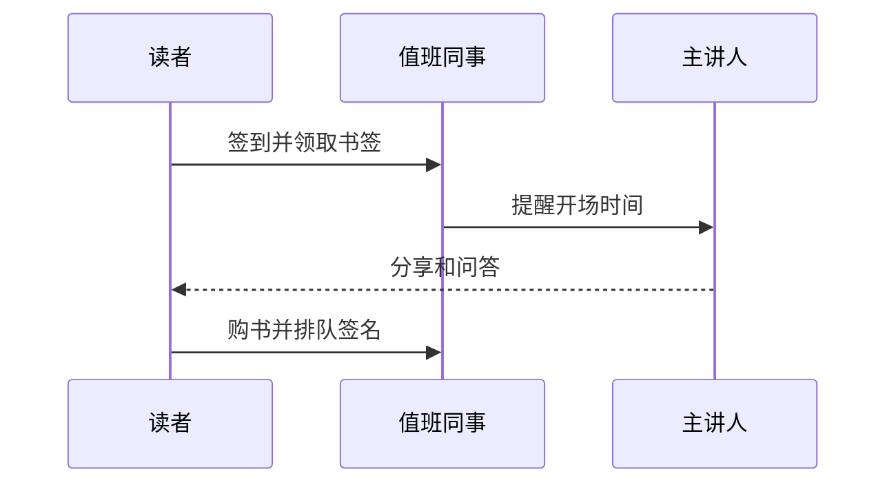

一场读书会从报名到收场要准备什么，周末值班和办活动的同事照着这页来。

# 活动的三种规模

书店每个月有两到三场活动。规模不同，准备也不同：

- **小型读书会**：十几个人，茶座拼桌就够。主持人是老读者，我们只负责茶水和签到。
- **作者见面会**：三十到五十人，要挪开楼上两排书架，提前一周报备街道。
- **亲子绘本日**：每月第二个周六上午，地上铺垫子，孩子比家长更吵，**别把手边的茶放在地上**。

# 提前一周

确认主讲人的到店时间和设备需求。投影仪在后仓第二层，遥控器单独放在店长抽屉里，这个位置别改。把活动信息更新到公众号和门口的小黑板，小黑板上的字要大，路过的人只看一眼。

# 活动当天

| 时间 | 事项 |
| --- | --- |
| 提前两小时 | 布置场地，测试投影和话筒 |
| 提前半小时 | 摆好签到表和相关书籍的小书架 |
| 开始后 | 一个人留在楼下照看收银，**楼上楼下不能同时没人** |
| 结束后 | 引导读者签售和结账，一小时内恢复书架 |

# 收场

清点签到人数和现场售书数量，记到活动登记表里，下次选题的时候有用。主讲人如果愿意，请他在留言墙写一句话，这面墙已经成了店里拍照最多的地方。

遇到现场有人录像或者直播，先问主讲人同不同意。不同意的话客气地请对方收起来，说明这是事先和嘉宾约好的。

:::callout{emoji="☕"}

活动结束后别忘了把茶座的桌子拼回去。第二天早班的同事如果发现桌子还是拼着的，是会记仇的。

:::
