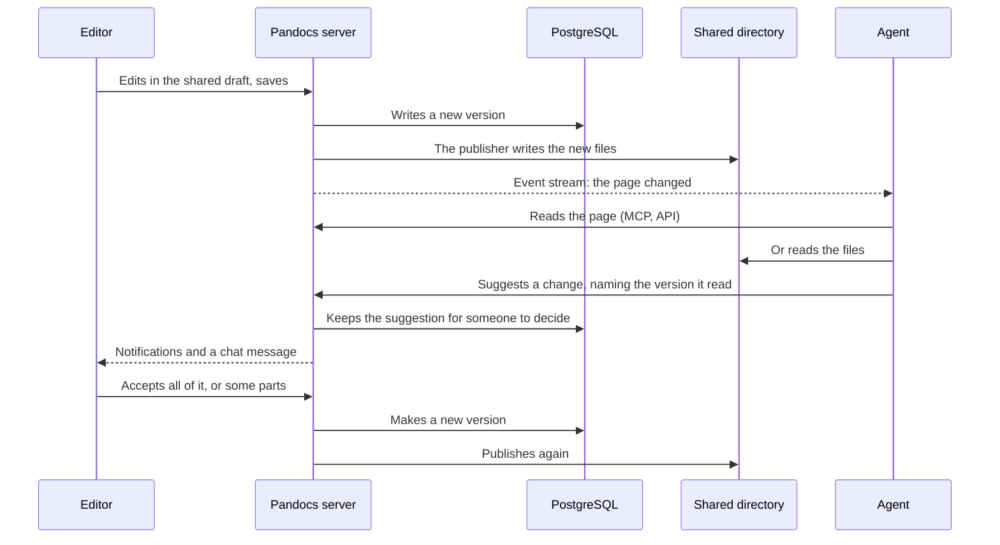

This page follows one change all the way: someone writes and saves, an agent reads it and suggests a change, someone accepts it, and the new version reaches everywhere again. Each step says who does it and where the data ends up. How the database, object storage and the shared directory read from and write to each other is in [Where data lives](../running/storage.md).

## Step by step

:::steps

### Someone writes and saves

Someone who can edit clicks **Edit** and joins the page's shared draft. Everyone in it sees each other's text and carets, and the draft is stored in the database every few seconds, whichever server people reached. Readers keep seeing the saved version.

An image is uploaded as soon as it is inserted: the file goes to object storage, and the text keeps only its address.

**Save** turns the draft into a new version, with who saved it, who else wrote in the draft, and which way the change came in.

### The change goes out

The new version and a row saying what changed are written to the database in one transaction. Then:

- People following the page or its space are notified, and chats with a webhook get a message.
- Agents subscribed to the event stream (`GET /api/v1/events`) hear about it at once.
- Local copies kept by `pandocs sync --watch` catch up within about a second.
- Files in the shared directory are replaced, and `.pandocs/CURRENT` changes. Another machine reads the new file about half a second later over NFSv4.

### The agent reads

An agent never reads more than the person it works for.

| How | What it reads |
| --- | --- |
| MCP `doc_get`, `doc_search` | Live content, filtered for that person. The revision returned is the one to name when suggesting |
| `pandocs sync` | A local copy, filtered for that person |
| The shared directory | The unrestricted pages of chosen spaces, the same for everyone with the mount |

### The agent suggests a change

An agent cannot save, and calling `doc_update` is refused. MCP `proposal_create`, or `pandocs commit` with an agent token, makes a **suggestion** instead, which names the version it started from and why it changes things.

To change several pages at once, use a [change set](../collaboration/change-sets.md): the pages are reviewed together, and merging applies all of them or none.

### A person decides

Someone with edit rights sees it under **Suggestions** at the top of the page, and under **Notifications** with the others waiting for them. They can accept only some parts, or reject it with a reason.

Accepting makes a new version, authored by whoever accepted it, whose message says whose suggestion it was. The person the agent works for hears the outcome, and discussions linked to the suggestion are resolved.

### The new version goes out again

A version made by accepting goes everywhere the first one did: notifications, the event stream, local copies and the shared directory. If people are still in the shared draft, it comes into their draft as well, as the next section explains.

:::

## When both sides changed

The server knows which version every change started from, so nobody overwrites anyone without knowing:

| What happened | Result |
| --- | --- |
| The suggestion started from an older version, and the page has changed elsewhere since | Accepting merges by block, three ways, and both changes stay |
| The page has changed in the same place | Accepting fails, and the agent suggests again from the new version |
| `pandocs commit` finds newer content on the server | It merges by block and writes the result to the local file. If both changed the same place, it stops with exit code 3 and leaves both alone |
| People are in the shared draft when a new version arrives | Changes in different places are both kept, and appear in everyone's editor at once. In the same place, the draft keeps its text and everyone in it is told. The next save replaces that part, and the version stays in the history |

## Who can do what

| | Read | Comment, suggest | Save, accept suggestions, merge change sets |
| --- | --- | --- | --- |
| Viewer | ✓ | | |
| Commenter | ✓ | ✓ | |
| Editor and administrator | ✓ | ✓ | ✓ |
| Agent | What the person it works for can | If the person it works for can | |

`pandocs commit` with a personal token makes a version directly, the same as saving on the web. Add `--propose` to have someone look first.
