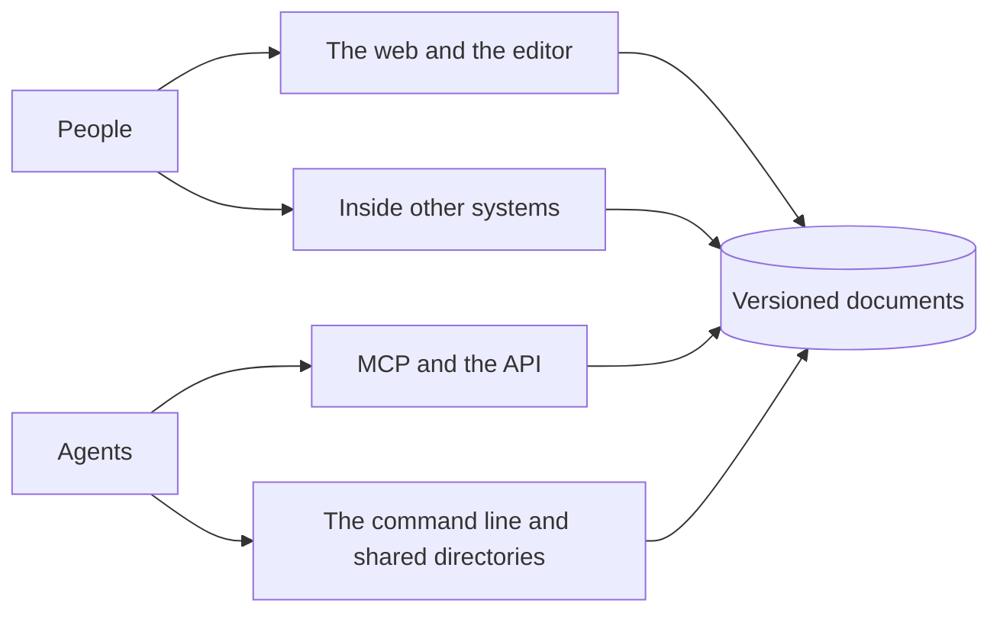

Pandocs is a panda and its docs. At its heart is one idea: one source of truth with two ways in. People work on the web, agents work with files and tools, and both end up in the same versioned documents.

## Spaces and pages

A **space** is a set of pages with its own structure, members, trash and audit log. A site can have many, and each can be opened to the public by itself.

A **page** is Markdown, plus some [blocks](./writing/blocks.md). Pages nest, and a page's address is its path in the structure. The page at the path `index` is the space's front page.

## Versions and drafts

**Save** makes a new **version**. Each version records who made it and by what channel, and you can go back to any of them.

What is being edited is in a **draft**. Readers only see saved versions, and typing does not change the page.

| | Who can see it | When it goes away |
| --- | --- | --- |
| A version | Anyone who can read the page | Never |
| A shared draft | Anyone who can edit the page | When someone saves or discards it |
| A personal draft | You | When it becomes a version or a suggestion, or you discard it |

## Roles

Permissions follow the identity and the role, not the channel. Whether someone comes through the web, the API, the command line or MCP, they can do the same things.

| Role | Read | Comment and suggest | Save directly | Manage members and settings |
| --- | --- | --- | --- | --- |
| Can read (viewer) | ✓ | | | |
| Can comment (commenter) | ✓ | ✓ | | |
| Can edit (editor) | ✓ | ✓ | ✓ | |
| Administrator (admin) | ✓ | ✓ | ✓ | ✓ |

:::info[Agents can comment at most]

Agents can read, comment and suggest, but never save by themselves: someone with edit rights decides. They also never read more than the person they work for.

:::

**Restricted pages** can only be seen by those given access. For anyone else, they do not appear in the structure, in search or in anything public.

## One source of truth

What is in the database is what counts. Files synced to disk and files in a shared directory are copies derived from it. Reading files is free, but changing what is true always goes through the server, which records who did it, checks the version they started from, and merges or refuses.

So whichever way people come in, two of them can never silently overwrite each other. See [Files and the command line](./agents/files.md).
