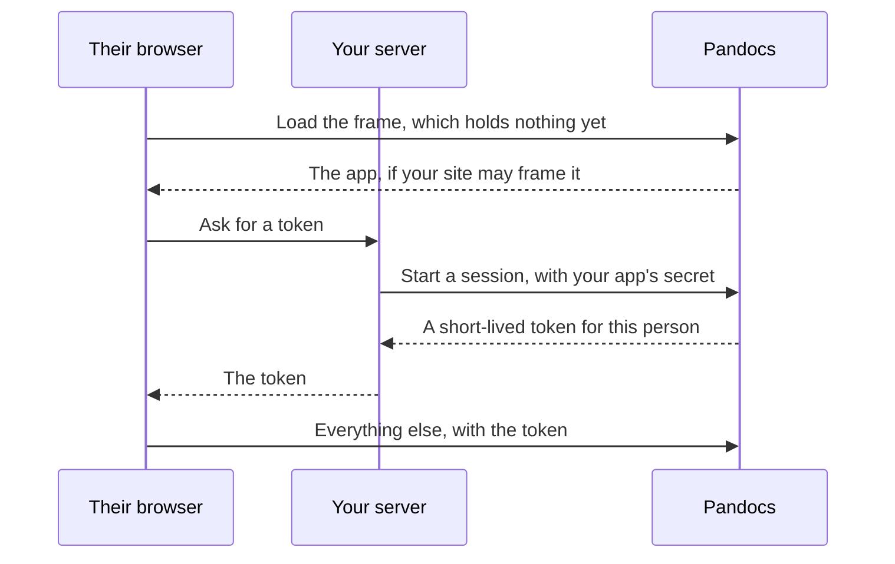

A page can live inside another web app, with reading, comments and suggestions working as they do on the site. It is the same page, in a frame, so the two cannot drift apart. The only addition is that your system says who its users are.



Your server decides who the person is. Pandocs trusts it for that and nothing else: what they can reach is still decided here.

:::::steps

### Add the app

As an administrator, go to **Embed apps**, and give it a name, an identifier such as `helpdesk`, and the sites allowed to frame it. The secret is shown once, so save it where your server can read it.

### Grant access

Visitors from another system get nothing by default. In a space's **Members**, add `group:embed:helpdesk` with the role they should have.

To treat some of them differently, send groups with the session. A person in group `support` is also in `group:embed:helpdesk:support`, which can have its own role.

### Hand out tokens from your server

```js
app.get("/your/pandocs-token", requireLogin, async (req, res) => {
  const answer = await fetch("https://docs.example.com/api/v1/embed/sessions", {
    method: "POST",
    headers: { authorization: `Bearer ${process.env.PANDOCS_EMBED_SECRET}`, "content-type": "application/json" },
    body: JSON.stringify({ user: { id: req.user.id, displayName: req.user.name, groups: req.user.teams } })
  });
  const { data } = await answer.json();
  res.type("text/plain").send(data.token);
});
```

### Put the page in

::::tabs

:::tab[No build step]

```html
<pandocs-doc server="https://docs.example.com" app="helpdesk" space="handbook" path="getting-started" style="height: 800px"></pandocs-doc>
<script type="module">
  import "https://docs.example.com/embed.js";
  document.querySelector("pandocs-doc").getToken = async () => (await fetch("/your/pandocs-token")).text();
</script>
```

:::

:::tab[React]

```jsx
import { PandocsDoc } from "@pandocs/embed/react";

<PandocsDoc
  server="https://docs.example.com"
  app="helpdesk"
  space="handbook"
  path="getting-started"
  style={{ height: 800 }}
  getToken={async () => (await fetch("/your/pandocs-token")).text()}
/>;
```

:::

::::

:::::

## Attributes and events

| Attribute | |
| --- | --- |
| `server` | The site's address |
| `app` | The app's identifier |
| `space`, `path` | The page. Change them to go somewhere else. They follow along when someone follows a link inside |
| `theme` | `light` or `dark`, and it can change at any time |
| `lang` | `en` or `zh`. Otherwise it follows the browser |
| `sidebar` | Present to show the space's pages beside the page |

| Event | |
| --- | --- |
| `pandocs-ready` | The page has a token and is loading |
| `pandocs-navigate` | Someone went to another page, and `event.detail.path` says where |
| `pandocs-error` | Getting a token went wrong, and `event.detail.error` says what |

## What keeps this safe

- **The secret stays on your server.** It is only a hash here.
- **Tokens are short-lived**, an hour by default and twelve at most, held in memory in the frame, with no reliance on cookies.
- **Only listed sites can frame it**, enforced by browsers through `frame-ancestors`.
- **A token cannot do what a guest should not.** Account pages, API tokens, the people directory, administration and MCP are closed to it, whatever role it has been granted.
- **Disabling an app stops all its tokens at once.** Replacing the secret stops new tokens only, as those already out stay valid until they run out.
