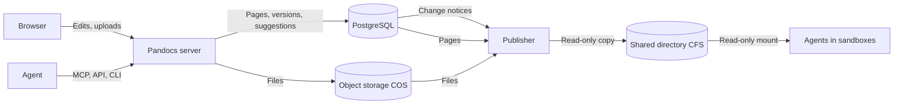
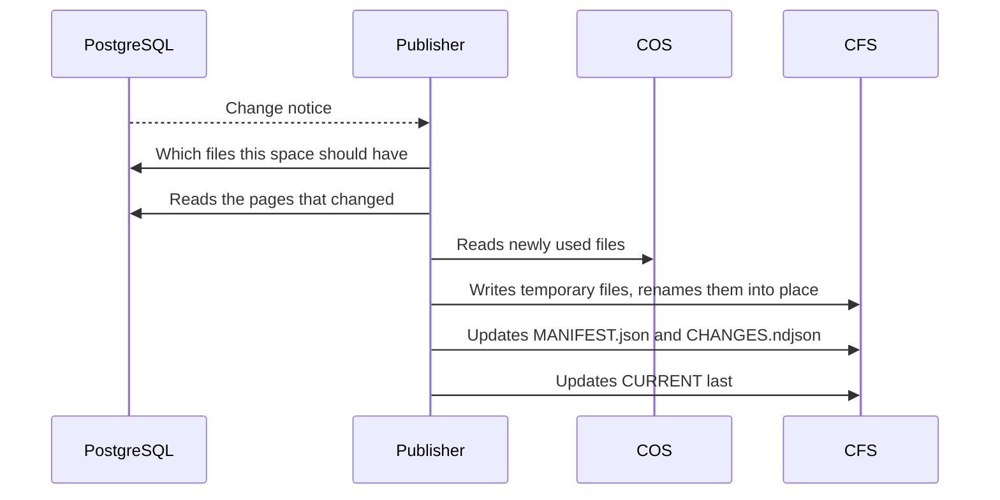
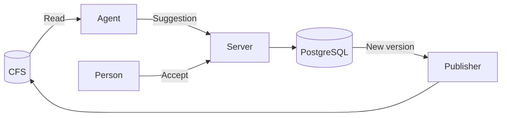

Pandocs keeps data in three places. The database is the source of truth, object storage holds the files themselves, and the shared directory is a copy for agents to read. The examples below use Tencent Cloud's COS and CFS. S3 and EFS, or OSS and NAS, work the same way.

| | What it holds | Who reads and writes it |
| --- | --- | --- |
| PostgreSQL | Pages' Markdown and every version, shared drafts, comments, suggestions, change sets, translations, accounts and permissions, a record of each file, what changed | Only the server. Back it up |
| Object storage (COS) | Uploaded images, videos, PDFs and other files themselves, and an import's archive while it runs | Only the server. Back it up |
| Shared directory (CFS) | The unrestricted pages of chosen spaces and the files they use | The publisher writes, and agents mount it read-only. No backup needed: it rebuilds itself |

Neither browsers nor agents connect to the database or object storage. Every read and write goes through the server, which checks permissions.



## Writing: text to the database, files to object storage

Inserting an image in the editor and saving goes like this:

1. The browser sends the image to the server (`POST /api/v1/spaces/{space}/assets`).
2. The server decides its type from its content rather than its extension, and works out its SHA-256. The file goes to COS under `pandocs/spaces/<space id>/<sha256>`, the prefix being `PANDOCS_S3_PREFIX`. Its type, size, original name and uploader are recorded in the database. The same file uploaded twice is stored once, and a file can be up to 100 MiB.
3. The text refers to it as `assets/<sha256>.png`. Saving writes only the Markdown to the database, as a new version.

Every other way in works the same: images converted out of imported files, images Git sync brings from a repository, and files agents upload through the API all go to COS by their content. The archive uploaded for an import waits at `pandocs/imports/<import id>` and is deleted once the import ends or is cancelled.

An image taken out of the text stays in COS, since older versions still use it.

## Reading: always through the server

- **Pages**: the server reads the current version from the database and sends it rendered. Agents reading through MCP or the API get what is in the database as well.
- **Files**: their address is `/api/v1/spaces/{space}/assets/<sha256>.<extension>`. On every request the server checks permissions, then fetches the file from COS, so the bucket stays private and needs no signed addresses. The address is the content, which never changes, so browsers may cache it for a year. Visitors without a login only get files that public pages use.

## From the database and COS to CFS

Only the **publisher** writes to CFS, and only one way: from the database and COS to CFS. Nothing reads CFS back. A file someone changes there has no effect, and the next round changes it back.



A round goes like this:

1. The database sends a notice with every change. The publisher waits 0.3 seconds after one, to take what came meanwhile in the same round.
2. It works out which files each space should have: unrestricted pages as `.md`, and the files they use in `assets/`. Restricted pages, and files only they use, are never written.
3. It compares that with the `MANIFEST.json` already there, and writes only what changed. Pages come from the database, files from COS.
4. Every file is written under a temporary name and renamed into place, so nobody reads half a file. New files are in place first, then the manifest changes, and files no longer needed go last.
5. `.pandocs/CURRENT` changes last of all. Seeing it change means everything before it is there.

Besides that:

- Every five minutes a full round compares the files actually there as well, bringing back what was removed and clearing what should not be there.
- `.pandocs/pack.tar.gz` is packed again every `PANDOCS_PUBLISH_PACK_SECONDS`, 300 by default.
- Any number of replicas can publish. A lock in the database lets one write, and another takes over within seconds if it stops.
- Publishing runs in a process of its own. A CFS mount that hangs only delays the files, and the site keeps answering.
- The publisher needs the database and COS, and CFS to write to. Replicas serving pages do not need the mount: `PANDOCS_ROLES=publisher` leaves publishing to one or two of them.

## Agents read CFS, and changes go through the server

Agents with CFS mounted can only read:

```bash
# A few reads: straight from the mount
cat /mnt/shared/pandocs/handbook/getting-started.md

# Searching everything: copy it to a local disk first, under a second for ten thousand pages
pandocs sync handbook ./work --from /mnt/shared/pandocs/handbook --watch
```

To change anything, an agent needs a way to the server, and suggests through MCP or `pandocs commit`. Once someone accepts, there is a new version, which the publisher writes to CFS. The loop as a whole:



[Updating together](../agents/together.md) follows the whole process.

## How long each part takes

| Part | Time |
| --- | --- |
| A shared draft reaching the database | 8 seconds at most |
| The event stream after a save | As soon as the transaction commits |
| Files on CFS after a save | The publisher waits 0.3 seconds. Another machine sees the file in about half a second over NFSv4, and about 6 seconds over NFSv3 |
| `pack.tar.gz` | Up to 5 minutes behind, by default |
| A full round on CFS | Every 5 minutes |

The CFS numbers were measured on a kernel NFS server, not Tencent Cloud's service. What to know when reading from CFS is in [Files and the command line](../agents/files.md).

## Settings

| Setting | What it does |
| --- | --- |
| `PANDOCS_STORAGE` | `local` or `s3`. It is `s3` when `PANDOCS_S3_BUCKET` is set |
| `PANDOCS_DATA_DIR` | The directory for files without object storage. `/data` in the image |
| `PANDOCS_S3_BUCKET`, `PANDOCS_S3_REGION`, `PANDOCS_S3_ENDPOINT` | Bucket, region and service address. A COS bucket name ends in your APPID, and the address looks like `https://cos.ap-guangzhou.myqcloud.com` |
| `PANDOCS_S3_PREFIX` | What object keys start with, `pandocs/` by default |
| `PANDOCS_PUBLISH_DIR`, `PANDOCS_PUBLISH_SPACES` | Where CFS is mounted, and the spaces to publish. The spaces have to be listed, or `*` for all |
| `PANDOCS_ROLES` | A replica with `publisher` only publishes |

Keys go in the standard `AWS_ACCESS_KEY_ID` and `AWS_SECRET_ACCESS_KEY`, which for COS hold a SecretId and SecretKey. Mount CFS over NFSv4 (`vers=4.0,noresvport`), and read-only in agents' sandboxes. [Deploying](./deploy.md) has the settings for each cloud.

## Backups

Back up PostgreSQL and COS, and that is everything: CFS is derived and needs no backup. Dump the database first and copy the files from COS after, so the copy has every file the database uses.
