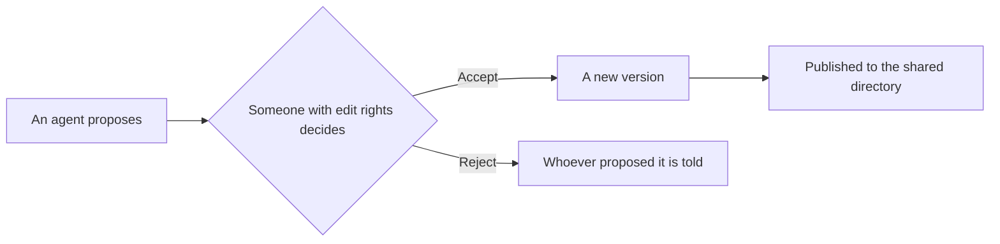
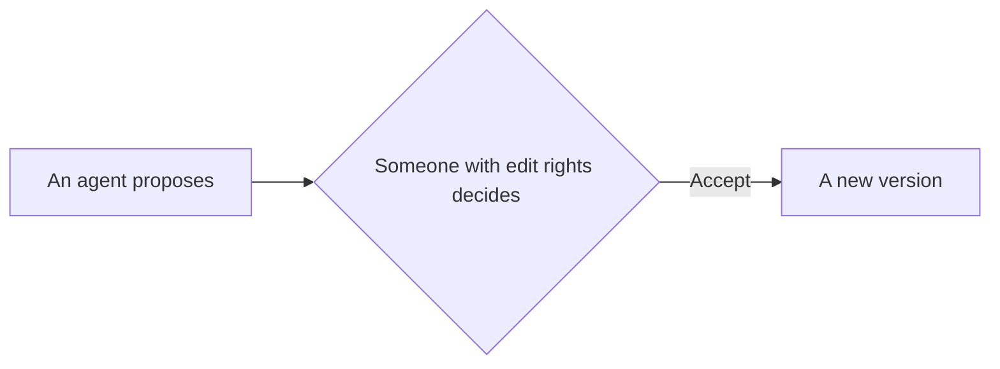

All of ordinary Markdown works: headings, lists, tables, code, links and images. This page lists the blocks added on top, each with its real result and its source to expand. Type `/` in the editor to insert them too.

## Callouts

:::tip[A tip]

A callout with a title. Without one, it shows a default name.

:::

:::note

A note: something to add.

:::

:::info

Information: something general.

:::

:::warning

A warning: this is easy to get wrong.

:::

:::danger

Danger: this cannot be undone.

:::

:::callout{emoji="👋"}

`callout` takes its look from an emoji: 💡 shows as a tip, ❌ as danger, and 👋 and anything else as a note.

:::

::::::details[Show the source]

```md
:::tip[A tip]

A callout with a title.

:::

:::callout{emoji="👋"}

A callout taking its look from an emoji.

:::
```

GitHub's way of writing them works too: `> [!NOTE]` shows as the matching callout.

::::::

## Collapsible sections

:::details[Click here to expand]

What is folded away takes no room until someone wants it.

:::

::::::details[Show the source]

```md
:::details[Click here to expand]

What is folded away.

:::
```

::::::

## Steps

:::steps

### The first step

Each heading is a step.

### The second step

A step can hold anything, including code and images.

:::

::::::details[Show the source]

```md
:::steps

### The first step

Each heading is a step.

### The second step

A step can hold anything.

:::
```

::::::

## Tabs

::::tabs{group="system"}

:::tab[macOS]

Tabs with the same `group` switch together. Try the other one.

:::

:::tab[Windows]

Here is what it says for Windows.

:::

::::

::::tabs{group="system"}

:::tab[macOS]

This set follows the one above to macOS.

:::

:::tab[Windows]

This set follows the one above to Windows.

:::

::::

::::::details[Show the source]

```md
::::tabs{group="system"}

:::tab[macOS]

What it says for macOS.

:::

:::tab[Windows]

What it says for Windows.

:::

::::
```

An outer container has more colons than the one inside it.

::::::

## Cards

::::cards

:::card[Five-minute start]{href="../start.md"}

A card can link to another page, and the link follows when that page moves.

:::

:::card[Concepts]{href="../concepts.md"}

A card with no link is just a piece of content.

:::

::::

::::::details[Show the source]

```md
::::cards

:::card[Five-minute start]{href="../start.md"}

A card can link to another page.

:::

::::
```

::::::

## Columns

::::columns

:::column{width="0.6"}

The left column takes 60%, here for an explanation. On a narrow screen they stack.

:::

:::column{width="0.4"}

The right column takes 40%.

:::

::::

::::::details[Show the source]

```md
::::columns

:::column{width="0.6"}

The left column.

:::

:::column{width="0.4"}

The right column.

:::

::::
```

::::::

## Diagrams

Written in Mermaid. Click one to enlarge it.



::::::details[Show the source]

````md

````

::::::

## Charts

The types are `bar`, `line`, `area` and `pie`. This is sample data.

```chart title="New pages each month (sample data)"
{"type":"bar","xKey":"Month","data":[{"Month":"Jan","Pages":12},{"Month":"Feb","Pages":19},{"Month":"Mar","Pages":31},{"Month":"Apr","Pages":28},{"Month":"May","Pages":44},{"Month":"Jun","Pages":52}]}
```

::::::details[Show the source]

````md
```chart title="New pages each month"
{"type":"bar","xKey":"Month","data":[{"Month":"Jan","Pages":12},{"Month":"Feb","Pages":19}]}
```
````

::::::

## Mind maps

```mindmap
# Pandocs

- Read
  - Search
  - Ask AI
  - Present
- Write
  - The editor
  - The command line
- Collaborate
  - Comments
  - Suggestions
  - Change sets
```

::::::details[Show the source]

````md
```mindmap
# Pandocs

- Read
  - Search
- Write
  - The editor
```
````

::::::

## File trees

```tree
my-docs
├── getting-started.md
├── guide
│   ├── install.md    # A note goes after a hash
│   └── upgrade.md
└── changelog.md
```

::::::details[Show the source]

````md
```tree
my-docs
├── getting-started.md
└── guide
    └── install.md    # A note goes after a hash
```
````

::::::

## Prompts

Words for a reader to copy with one click, shown exactly as written with no Markdown parsing.

```prompt title="Read these documents" description="Paste this to your agent"
Read this site's llms.txt, tell me how to deploy it, and list what I need to prepare first.
```

::::::details[Show the source]

````md
```prompt title="Read these documents" description="Paste this to your agent"
Read this site's llms.txt and tell me how to deploy it.
```
````

::::::

## Formulas

Written with `$$` and typeset by KaTeX. A single `$` is ordinary text, so prices do not become formulas.

$$\sum_{i=1}^{n} i = \frac{n(n+1)}{2}$$

::::::details[Show the source]

```md
$$\sum_{i=1}^{n} i = \frac{n(n+1)}{2}$$
```

::::::

## Notes on a screenshot

Move the pointer over the dots. Positions are percentages of the image's width and height, and in the editor you click on the image to add one.

```hotspots src="assets/reading-light-en.webp" alt="A page being read"
[{"x":13,"y":22,"title":"Structure","text":"The pages of the space, which can be dragged into order under Manage pages."},{"x":50,"y":27,"title":"What to do with a page","text":"Copy Markdown, comment, edit, history, follow and share."},{"x":88,"y":27,"title":"Outline","text":"The page's headings, following where you are reading."},{"x":72,"y":4,"title":"Search","text":"Finds pages with the permissions of whoever is signed in. With a model set up, Ask AI is next to it."}]
```

::::::details[Show the source]

````md
```hotspots src="assets/screen.png" alt="A page being read"
[{"x":10,"y":30,"title":"Structure","text":"The pages of the space."}]
```
````

::::::

## Before and after

Drag the divider. This compares the same page in light and dark mode.

::compare[Light and dark]{before="assets/reading-light-en.webp" after="assets/reading-dark-en.webp" beforeLabel="Light" afterLabel="Dark"}

::::::details[Show the source]

```md
::compare[Light and dark]{before="assets/light.png" after="assets/dark.png" beforeLabel="Light" afterLabel="Dark"}
```

::::::

## Subpages

Lists a page's subpages by itself, so there is nothing to keep up when pages come and go. [Writing](../writing.md) uses it.

::::::details[Show the source]

```md
::subpages
```

::::::

## API references

Upload an OpenAPI document, or give an address on this site, and a page becomes an interactive reference. See the [API reference](../agents/api-reference.md).

::::::details[Show the source]

```md
::openapi{src="/api/v1/openapi.yaml"}
```

::::::

## Video and files

Upload them, then insert them. Both work in the editor.

::::::details[Show the source]

```md
::video[Product demo]{src="assets/demo.mp4"}

::file[Quarterly report.pdf]{src="assets/report.pdf"}
```

::::::

## Small things in the text

**Bold**, *italic*, ~~struck through~~, `inline code`, superscript x^2^, subscript H~2~O, tags :tag[Done]{tone="tip"} :tag[Careful]{tone="warning"}, and a footnote[^1].

[^1]: A footnote's text shows at the end of the page.

- [x] A task list
- [ ] Something not done yet


A code block can have a title:

```ts title="client.ts"
const greeting = "A code block can have a title";
console.log(greeting);
```

::::::details[Show the source]

````md
x^2^, H~2~O, :tag[Done]{tone="tip"}, a footnote[^1]

[^1]: A footnote's text.


```ts title="client.ts"
console.log("A code block can have a title");
```
````

A single `~` is not strikethrough, so ranges such as `1~3 days` stay as they are.

::::::
