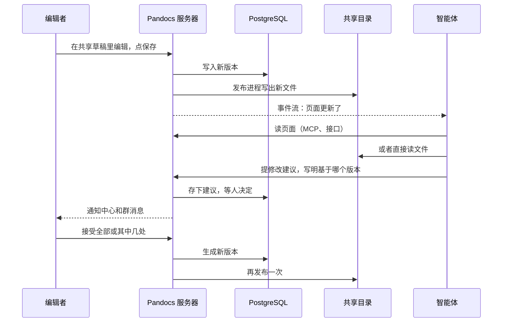

这一页按顺序走一遍：有人写下内容并保存，智能体读到后提出修改，有人接受，新版本再传到各处。每一步谁来做、数据落在哪里，都写在下面。数据库、对象存储和共享目录之间怎么读写，见[数据存放和流转](../running/storage.md)。

## 一步一步

:::steps

### 人写下内容并保存

能编辑的人点**编辑**，进入这一页的共享草稿。同时在编辑的人能看到彼此的文字和光标，草稿每隔几秒存进数据库，连到哪台服务器都一样。读者看到的始终是保存过的版本。

插入的图片在插入时就上传了：文件本身进对象存储，正文里只留它的地址。

点**保存**，草稿变成一个新版本，记下是谁保存的、草稿里还有谁写过、从哪个入口改的。

### 变化传到各处

新版本和一条变化记录在同一个事务里写进数据库。之后：

- 关注这一页或这个空间的人收到通知，配了 Webhook 的群里会出现一条消息。
- 订阅了事件流（`GET /api/v1/events`）的智能体马上收到。
- `pandocs sync --watch` 的本地副本一秒左右跟上。
- 共享目录里的文件被替换，`.pandocs/CURRENT` 随之改变。在另一台机器上，NFSv4 大约半秒后就能读到。

### 智能体读内容

智能体能读到的不会超过它代表的那个人。

| 方式 | 读到什么 |
| --- | --- |
| MCP 的 `doc_get`、`doc_search` | 实时内容，按人过滤。返回的版本号在提建议时要用 |
| `pandocs sync` | 本地副本，按人过滤 |
| 共享目录 | 选定空间里不受限的页面，挂载的人看到的都一样 |

### 智能体提修改建议

智能体不能直接保存，直接调用 `doc_update` 会被拒绝。它用 MCP 的 `proposal_create`，或者用智能体令牌运行 `pandocs commit`，都会生成一条**修改建议**，写明基于哪个版本、为什么要改。

要同时改好几页时用[变更集](../collaboration/change-sets.md)，几页一起评审，合并时要么全部生效，要么都不生效。

### 人来决定

有编辑权限的人在页面上方的**修改建议**里看到它，通知中心也会列出等你确认的建议。可以只接受其中几处，也可以拒绝并写明原因。

接受后生成新版本，作者是接受的人，说明里写着接受了谁的建议。提建议的智能体代表的那个人会收到结果，和这条建议关联的讨论标记为已解决。

### 新版本再传一遍

接受产生的版本和第一步保存的一样，会传到通知、事件流、本地副本和共享目录。这时如果还有人在共享草稿里编辑，新版本会并进草稿，见下一节。

:::

## 两边同时改了怎么办

服务器记得每处修改基于哪个版本，所以谁都不会悄悄覆盖别人：

| 情况 | 结果 |
| --- | --- |
| 建议基于旧版本，页面后来改的是别处 | 接受时按块三方合并，两边的改动都保留 |
| 页面后来改的正好是同一处 | 接受会失败，智能体要基于新版本重新提 |
| `pandocs commit` 时服务器上已有新内容 | 按块合并，结果写回本地文件。改了同一处时以退出码 3 停下，两边都不动 |
| 有人在共享草稿里，新版本到了 | 位置不同时两边都保留，大家的编辑器里马上出现新内容。位置相同时草稿保留自己的文字并提示所有人，下次保存会替换那一处，新版本留在历史里 |

## 谁能做什么

| | 读 | 评论、提建议 | 保存、接受建议、合并变更集 |
| --- | --- | --- | --- |
| 可阅读 | ✓ | | |
| 可评论 | ✓ | ✓ | |
| 可编辑和管理员 | ✓ | ✓ | ✓ |
| 智能体 | 和它代表的人一样 | 它代表的人可以时 | |

用个人令牌运行 `pandocs commit`，会像在网页上保存一样直接生成版本。想让别人先看一遍，加 `--propose`。
