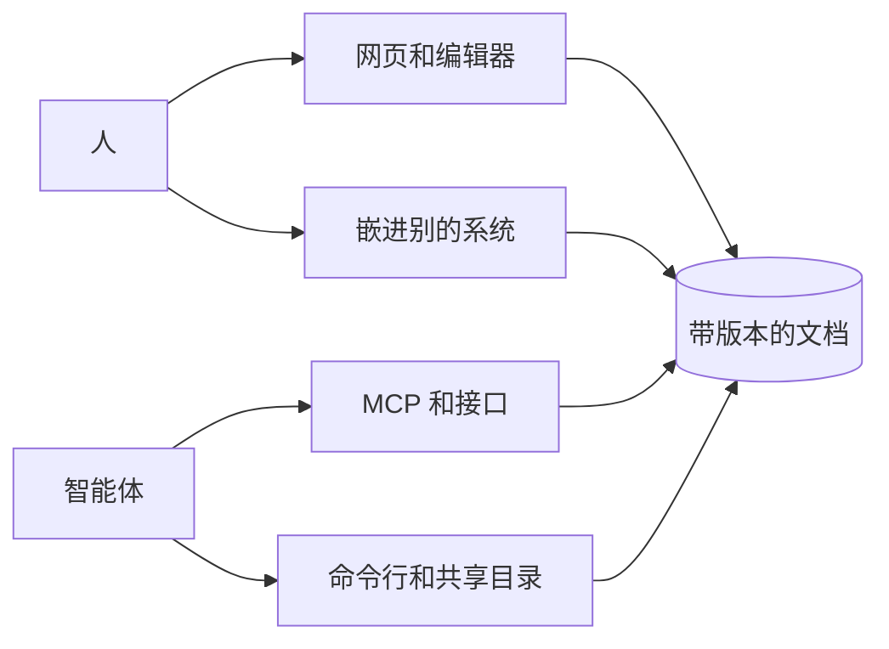

Pandocs 的名字是熊猫（panda）加文档（docs）。它的核心只有一句话：一个事实源，两个入口。人在网页上协作，智能体通过文件和工具协作，结果都落在同一份带版本的文档里。

## 空间和页面

**空间**是一组页面，有自己的目录、成员、回收站和操作记录。一个站点可以有很多空间，每个空间可以单独公开。

**页面**的内容是 Markdown，加上一些[内容块](./writing/blocks.md)。页面可以嵌套，地址就是它在目录里的路径。路径为 `index` 的页面是空间的首页。

## 版本和草稿

点**保存**会生成一个新**版本**。每个版本都记录是谁、通过什么渠道改的，随时可以回看和恢复。

正在编辑的内容在**草稿**里。读者只看到保存过的版本，打字不会改变页面。

| | 谁能看到 | 什么时候消失 |
| --- | --- | --- |
| 版本 | 能读这个页面的人 | 不会消失 |
| 共享草稿 | 能编辑这个页面的人 | 有人保存或丢弃 |
| 个人草稿 | 只有自己 | 变成版本或修改建议，或自己丢弃 |

## 角色

权限只看身份和角色，不看渠道。一个人从网页、接口、命令行还是 MCP 过来，能做的事都一样。

| 角色 | 读 | 评论、提建议 | 直接保存 | 管理成员和设置 |
| --- | --- | --- | --- | --- |
| 可阅读（`viewer`） | ✓ | | | |
| 可评论（`commenter`） | ✓ | ✓ | | |
| 可编辑（`editor`） | ✓ | ✓ | ✓ | |
| 管理员（`admin`） | ✓ | ✓ | ✓ | ✓ |

:::info[智能体最多只能评论]

智能体可以读、评论和提修改建议，但不能自己保存，要由有编辑权限的人决定。它能读到的也不会超过它代表的那个人。

:::

**受限页面**只有被单独授权的人能看到。对其他人来说，它们不会出现在目录、搜索和公开内容里。

## 事实源只有一个

数据库里的才算数。同步到本地的文件、共享目录里的文件都是从它派生出来的副本：读文件不受限制，但改内容一定要经过服务器。服务器会记录是谁改的，检查改动基于哪个版本，能合并就合并，合并不了就拒绝。

所以不管从哪个入口进来，两个人都不会悄悄覆盖对方的内容。详见[文件和命令行](./agents/files.md)。
