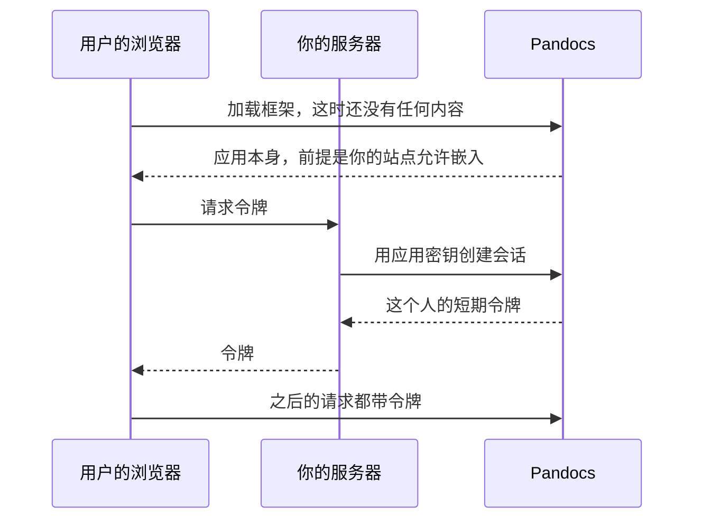

页面可以放进别的网页应用，查看、评论和建议都和站内一样。放进去的就是同一个页面，所以两边的内容不会不一致。唯一多出来的是：由你的系统告诉它用户是谁。



你的服务器决定这个人是谁，Pandocs 只在这一点上信任它。这个人能看到什么，还是由 Pandocs 决定。

:::::steps

### 添加应用

管理员在**嵌入应用**里填名称、标识（比如 `helpdesk`）和允许嵌入的站点。密钥只显示一次，存到你的服务器能读到的地方。

### 授权

其他系统来的用户默认什么都看不到。在空间的**成员**里添加 `group:embed:helpdesk` 并选角色。

要区别对待一部分人时，创建会话时带上分组。分组 `support` 里的人同时也在 `group:embed:helpdesk:support` 里，可以单独给角色。

### 在服务器上发令牌

```js
app.get("/your/pandocs-token", requireLogin, async (req, res) => {
  const answer = await fetch("https://docs.example.com/api/v1/embed/sessions", {
    method: "POST",
    headers: { authorization: `Bearer ${process.env.PANDOCS_EMBED_SECRET}`, "content-type": "application/json" },
    body: JSON.stringify({ user: { id: req.user.id, displayName: req.user.name, groups: req.user.teams } })
  });
  const { data } = await answer.json();
  res.type("text/plain").send(data.token);
});
```

### 放进页面

::::tabs

:::tab[不用构建工具]

```html
<pandocs-doc server="https://docs.example.com" app="helpdesk" space="handbook" path="getting-started" style="height: 800px"></pandocs-doc>
<script type="module">
  import "https://docs.example.com/embed.js";
  document.querySelector("pandocs-doc").getToken = async () => (await fetch("/your/pandocs-token")).text();
</script>
```

:::

:::tab[React]

```jsx
import { PandocsDoc } from "@pandocs/embed/react";

<PandocsDoc
  server="https://docs.example.com"
  app="helpdesk"
  space="handbook"
  path="getting-started"
  style={{ height: 800 }}
  getToken={async () => (await fetch("/your/pandocs-token")).text()}
/>;
```

:::

::::

:::::

## 属性和事件

| 属性 | |
| --- | --- |
| `server` | 站点地址 |
| `app` | 应用标识 |
| `space`、`path` | 显示哪个页面，改了就会跳过去，里面点链接时也会跟着变 |
| `theme` | `light` 或 `dark`，随时可以改 |
| `lang` | `en` 或 `zh`，不写就跟随浏览器 |
| `sidebar` | 写上就在旁边显示目录 |

| 事件 | |
| --- | --- |
| `pandocs-ready` | 拿到令牌，开始加载 |
| `pandocs-navigate` | 用户去了别的页面，`event.detail.path` 是地址 |
| `pandocs-error` | 拿令牌失败，`event.detail.error` 是原因 |

## 为什么安全

- **密钥留在你的服务器上。** 这边只存哈希。
- **令牌有效期短**，默认一小时，最长十二小时，只放在框架的内存里，不依赖 Cookie。
- **只有列出的站点能嵌入。** 由浏览器按 `frame-ancestors` 强制执行。
- **令牌做不了访客不该做的事。** 账号页、接口令牌、人员目录、管理功能和 MCP 都不开放，不管给了什么角色。
- **停用应用会让它的令牌全部失效。** 换密钥只影响新令牌，已发的要等过期。
