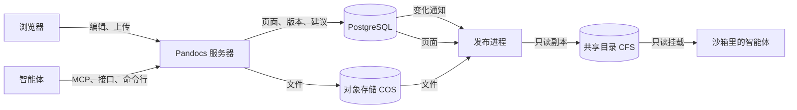
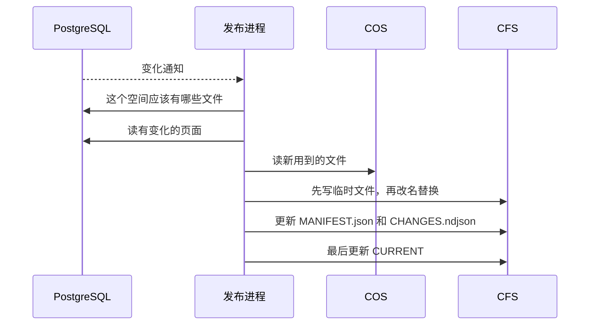
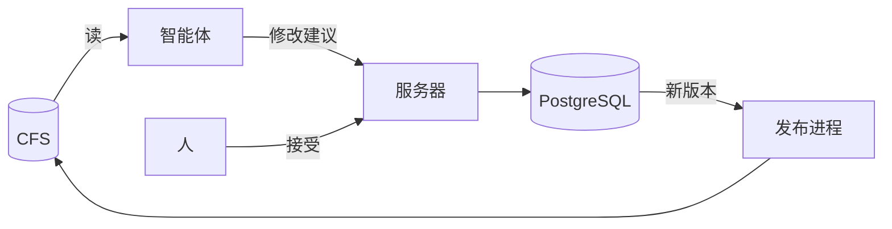

Pandocs 的数据放在三个地方。数据库是事实源，对象存储放文件本身，共享目录是给智能体读的副本。下面以腾讯云为例写作 COS 和 CFS，换成 S3 和 EFS、OSS 和 NAS 也是一样的。

| | 放什么 | 谁来读写 |
| --- | --- | --- |
| PostgreSQL | 页面的 Markdown 和全部版本、共享草稿、评论、修改建议、变更集、翻译、账号和权限、文件的登记信息、变化记录 | 只有服务器。要备份 |
| 对象存储（COS） | 上传的图片、视频、PDF 等文件本身，以及导入时临时放的压缩包 | 只有服务器。要备份 |
| 共享目录（CFS） | 选定空间里不受限的页面和它们用到的文件 | 只有发布进程写，智能体只读挂载。不用备份，删了会自动重建 |

浏览器和智能体都不直接连数据库和对象存储，所有读写都经过服务器，权限也在服务器上检查。



## 写入：正文进数据库，文件进对象存储

以在编辑器里插入一张图片再保存为例：

1. 浏览器把图片发给服务器（`POST /api/v1/spaces/{space}/assets`）。
2. 服务器按文件内容判断类型，不看扩展名，再算出 SHA-256。文件存进 COS，键是 `pandocs/spaces/<空间 ID>/<sha256>`，前缀由 `PANDOCS_S3_PREFIX` 决定。类型、大小、原文件名和上传人登记在数据库里。同一个文件传两次只存一份，单个文件最大 100 MiB。
3. 正文里写的是 `assets/<sha256>.png` 这样的地址。点保存时，只有 Markdown 作为新版本写进数据库。

别的入口也一样：导入文件时转换出来的图片、Git 同步从仓库带来的图片、智能体通过接口上传的文件，都按内容存进 COS。导入时上传的整个压缩包先放在 `pandocs/imports/<导入 ID>`，导入结束或取消后删掉。

图片从正文里删掉以后，文件还留在 COS 里，因为旧版本还用得到它。

## 读取：都经过服务器

- **页面**：服务器从数据库读当前版本，渲染好再给浏览器。智能体通过 MCP 或接口读的也是数据库里的内容。
- **文件**：地址是 `/api/v1/spaces/{space}/assets/<sha256>.<扩展名>`。每次请求服务器都先检查权限，再从 COS 取出返回，所以存储桶不用公开，也不需要签名地址。地址由内容决定，内容不会变，浏览器可以缓存一年。没登录的访客只能取到公开页面用到的文件。

## 从数据库和 COS 到 CFS

CFS 只由**发布进程**来写，方向是单向的：数据库和 COS 到 CFS。没有任何东西从 CFS 读回去，有人在里面改了文件也不会生效，下一轮会被改回来。



一轮发布是这样的：

1. 数据库每记下一条变化就发一个通知。发布进程收到后再等 0.3 秒，把这段时间里的变化攒成一轮。
2. 算出每个空间应该有哪些文件：不受限的页面写成 `.md`，它们用到的文件放进 `assets/`。受限页面和只有它们用到的文件不会写出去。
3. 和目录里现有的 `MANIFEST.json` 比，只写有变化的文件。页面从数据库读，文件从 COS 读。
4. 每个文件都先写成临时文件，再改名替换，读的人不会读到半个文件。顺序是新文件先就位，再换清单，最后删掉不再需要的文件。
5. 最后改 `.pandocs/CURRENT`。看到它变了，就说明前面的都写好了。

另外几件事：

- 每五分钟全量核对一次，连同目录里的实际文件一起比，补回被删掉的，清掉多出来的。
- `.pandocs/pack.tar.gz` 每 `PANDOCS_PUBLISH_PACK_SECONDS` 秒（默认 300 秒）重新打包一次。
- 多个副本都可以开启发布，数据库的咨询锁保证只有一个在写。它停了，另一个几秒内接手。
- 发布在单独的进程里运行。CFS 卡住只会耽误文件更新，网站照常响应。
- 发布进程要能连数据库和 COS，还要能写 CFS。提供页面的副本不用挂载 CFS，用 `PANDOCS_ROLES=publisher` 可以只让一两个副本负责发布。

## 智能体在 CFS 上读，改动经过服务器

挂载 CFS 的智能体只能读：

```bash
# 读得少，直接读挂载的目录
cat /mnt/shared/pandocs/handbook/getting-started.md

# 要全文搜索，先复制到本地盘，一万个页面不到一秒
pandocs sync handbook ./work --from /mnt/shared/pandocs/handbook --watch
```

要改内容，智能体必须能连上服务器，用 MCP 或 `pandocs commit` 提修改建议。人接受以后生成新版本，发布进程再把它写回 CFS。整个循环是：



完整的协作过程见[协同更新全流程](../agents/together.md)。

## 各环节大约多久

| 环节 | 时间 |
| --- | --- |
| 共享草稿存进数据库 | 最多 8 秒 |
| 保存后事件流推送 | 事务提交后马上 |
| 保存后 CFS 上的文件更新 | 发布进程先等 0.3 秒。在另一台机器上，NFSv4 大约半秒可见，NFSv3 大约 6 秒 |
| `pack.tar.gz` | 最多落后 5 分钟（默认值） |
| CFS 的全量核对 | 每 5 分钟 |

CFS 的数字是在内核 NFS 服务器上测的，不是腾讯云的服务。读 CFS 时的注意事项见[文件和命令行](../agents/files.md)。

## 配置

| 设置 | 作用 |
| --- | --- |
| `PANDOCS_STORAGE` | `local` 或 `s3`。设了 `PANDOCS_S3_BUCKET` 时默认是 `s3` |
| `PANDOCS_DATA_DIR` | 不用对象存储时文件放在哪个目录，镜像里是 `/data` |
| `PANDOCS_S3_BUCKET`、`PANDOCS_S3_REGION`、`PANDOCS_S3_ENDPOINT` | 存储桶、地域和服务地址。COS 的存储桶名带 APPID，地址形如 `https://cos.ap-guangzhou.myqcloud.com` |
| `PANDOCS_S3_PREFIX` | 对象键的前缀，默认 `pandocs/` |
| `PANDOCS_PUBLISH_DIR`、`PANDOCS_PUBLISH_SPACES` | CFS 的挂载点和要发布的空间。空间必须写明，`*` 表示全部 |
| `PANDOCS_ROLES` | 设成 `publisher` 的副本只负责发布 |

密钥用标准的 `AWS_ACCESS_KEY_ID` 和 `AWS_SECRET_ACCESS_KEY`，COS 填 SecretId 和 SecretKey。CFS 建议用 NFSv4 挂载（`vers=4.0,noresvport`），给智能体的沙箱只读挂载。各家云的写法见[部署](./deploy.md)。

## 备份

备份 PostgreSQL 和 COS 就是全部，CFS 是派生出来的，不用备份。先导出数据库，再复制 COS 里的文件，这样复制到的文件包含数据库里用到的全部。
