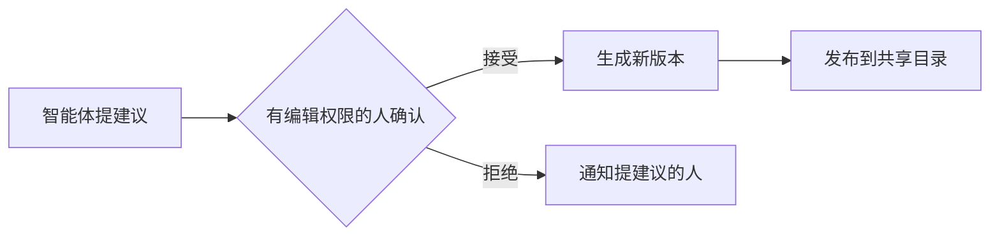
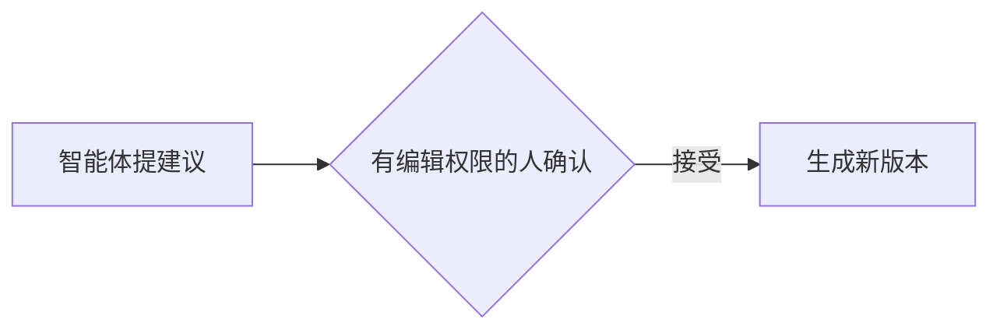

普通 Markdown 都能用：标题、列表、代码、表格、链接、图片。这一页列出在它之上增加的内容块，每种都有实际效果，展开就能看到源码。在编辑器里输入 `/` 也能插入它们。

## 提示块

:::tip[小技巧]

有标题的提示块。没有标题时显示默认的名称。

:::

:::note

备注：补充说明。

:::

:::info

说明：一般信息。

:::

:::warning

注意：这里容易出错。

:::

:::danger

危险：操作不能撤销。

:::

:::callout{emoji="👋"}

`callout` 用表情符号决定样式：💡 显示为提示，❌ 显示为危险，👋 和其他的显示为备注。

:::

::::::details[看源码]

```md
:::tip[小技巧]

有标题的提示块。

:::

:::callout{emoji="👋"}

用 emoji 决定样式的提示块。

:::
```

GitHub 的写法也能识别：`> [!NOTE]` 会按对应的提示块显示。

::::::

## 折叠

:::details[点这里展开]

折叠起来的内容，默认不占地方。

:::

::::::details[看源码]

```md
:::details[点这里展开]

折叠起来的内容。

:::
```

::::::

## 步骤

:::steps

### 第一步

每个标题是一步。

### 第二步

步骤里可以放任何内容，包括代码和图片。

:::

::::::details[看源码]

```md
:::steps

### 第一步

每个标题是一步。

### 第二步

步骤里可以放任何内容。

:::
```

::::::

## 标签页

::::tabs{group="system"}

:::tab[macOS]

相同 `group` 的标签页会一起切换，换一个试试。

:::

:::tab[Windows]

这里是 Windows 的说明。

:::

::::

::::tabs{group="system"}

:::tab[macOS]

这一组跟着上面一起变到 macOS。

:::

:::tab[Windows]

这一组跟着上面一起变到 Windows。

:::

::::

::::::details[看源码]

```md
::::tabs{group="system"}

:::tab[macOS]

macOS 的说明。

:::

:::tab[Windows]

Windows 的说明。

:::

::::
```

外层容器的冒号要比里层多。

::::::

## 卡片

::::cards

:::card[五分钟上手]{href="../start.md"}

卡片可以链接到其他页面，页面移动后链接会自动更新。

:::

:::card[基本概念]{href="../concepts.md"}

没有链接的卡片就是一块内容。

:::

::::

::::::details[看源码]

```md
::::cards

:::card[五分钟上手]{href="../start.md"}

卡片可以链接到其他页面。

:::

::::
```

::::::

## 分栏

::::columns

:::column{width="0.6"}

左边一栏占 60%，放说明文字。窄屏上会变成上下排列。

:::

:::column{width="0.4"}

右边一栏占 40%。

:::

::::

::::::details[看源码]

```md
::::columns

:::column{width="0.6"}

左边一栏。

:::

:::column{width="0.4"}

右边一栏。

:::

::::
```

::::::

## 流程图

用 Mermaid 写，点击可以放大。



::::::details[看源码]

````md

````

::::::

## 图表

类型有 `bar`、`line`、`area` 和 `pie`。下面是示例数据。

```chart title="每月新增页面（示例数据）"
{"type":"bar","xKey":"月份","data":[{"月份":"一月","页面":12},{"月份":"二月","页面":19},{"月份":"三月","页面":31},{"月份":"四月","页面":28},{"月份":"五月","页面":44},{"月份":"六月","页面":52}]}
```

::::::details[看源码]

````md
```chart title="每月新增页面"
{"type":"bar","xKey":"月份","data":[{"月份":"一月","页面":12},{"月份":"二月","页面":19}]}
```
````

::::::

## 脑图

```mindmap
# Pandocs

- 读
  - 搜索
  - 智能问答
  - 演示
- 写
  - 编辑器
  - 命令行
- 协作
  - 评论
  - 修改建议
  - 变更集
```

::::::details[看源码]

````md
```mindmap
# Pandocs

- 读
  - 搜索
- 写
  - 编辑器
```
````

::::::

## 文件树

```tree
my-docs
├── getting-started.md
├── guide
│   ├── install.md    # 注释写在井号后面
│   └── upgrade.md
└── changelog.md
```

::::::details[看源码]

````md
```tree
my-docs
├── getting-started.md
└── guide
    └── install.md    # 注释写在井号后面
```
````

::::::

## 提示词

给读者一段可以一键复制的话，内容原样显示，不解析 Markdown。

```prompt title="读这份文档" description="贴给你的智能体"
读一下这个站点的 llms.txt，告诉我怎么部署它，再列出部署前要准备什么。
```

::::::details[看源码]

````md
```prompt title="读这份文档" description="贴给你的智能体"
读一下这个站点的 llms.txt，告诉我怎么部署它。
```
````

::::::

## 公式

用 `$$` 写，由 KaTeX 排版。单个 `$` 是普通文字，所以价格不会变成公式。

$$\sum_{i=1}^{n} i = \frac{n(n+1)}{2}$$

::::::details[看源码]

```md
$$\sum_{i=1}^{n} i = \frac{n(n+1)}{2}$$
```

::::::

## 截图标注

把鼠标移到圆点上看说明。坐标是图片宽高的百分比，在编辑器里可以直接点图片添加。

```hotspots src="assets/reading-light-zh.webp" alt="阅读页面"
[{"x":13,"y":22,"title":"目录","text":"空间里的页面，在管理目录里可以拖动排序。"},{"x":50,"y":27,"title":"页面操作","text":"复制 Markdown、评论、编辑、历史、关注和分享。"},{"x":88,"y":27,"title":"大纲","text":"当前页面的标题，跟着阅读位置走。"},{"x":72,"y":4,"title":"搜索","text":"按当前登录的人的权限查找页面。配置模型后旁边还有智能问答。"}]
```

::::::details[看源码]

````md
```hotspots src="assets/screen.png" alt="阅读页面"
[{"x":10,"y":30,"title":"目录","text":"空间里的页面。"}]
```
````

::::::

## 前后对比

拖动中间的分界线。这里对比的是同一个页面的日间和夜间模式。

::compare[日间和夜间]{before="assets/reading-light-zh.webp" after="assets/reading-dark-zh.webp" beforeLabel="日间" afterLabel="夜间"}

::::::details[看源码]

```md
::compare[日间和夜间]{before="assets/light.png" after="assets/dark.png" beforeLabel="日间" afterLabel="夜间"}
```

::::::

## 子页面

自动列出当前页面的子页面，增删页面后不用手动维护。[写文档](../writing.md)这一页用的就是它。

::::::details[看源码]

```md
::subpages
```

::::::

## 接口参考

上传 OpenAPI 文档，或者写一个本站的地址，页面就变成可交互的接口参考。看[接口参考](../agents/api-reference.md)。

::::::details[看源码]

```md
::openapi{src="/api/v1/openapi.yaml"}
```

::::::

## 视频和文件

上传后插入，都可以在编辑器里操作。

::::::details[看源码]

```md
::video[产品演示]{src="assets/demo.mp4"}

::file[季度报告.pdf]{src="assets/report.pdf"}
```

::::::

## 文字里的小东西

**粗体**、*斜体*、~~删除线~~、`行内代码`、上标 x^2^、下标 H~2~O、行内标签 :tag[已完成]{tone="tip"} :tag[注意]{tone="warning"}，还有脚注[^1]。

[^1]: 脚注的内容显示在页面最后。

- [x] 任务列表
- [ ] 还没做完的一项


代码块可以有标题：

```ts title="client.ts"
const greeting = "代码块可以有标题";
console.log(greeting);
```

::::::details[看源码]

````md
x^2^、H~2~O、:tag[已完成]{tone="tip"}、脚注[^1]

[^1]: 脚注的内容。


```ts title="client.ts"
console.log("代码块可以有标题");
```
````

单个 `~` 不算删除线，所以 `1~3 天` 这样的写法不会被吞掉。

::::::
